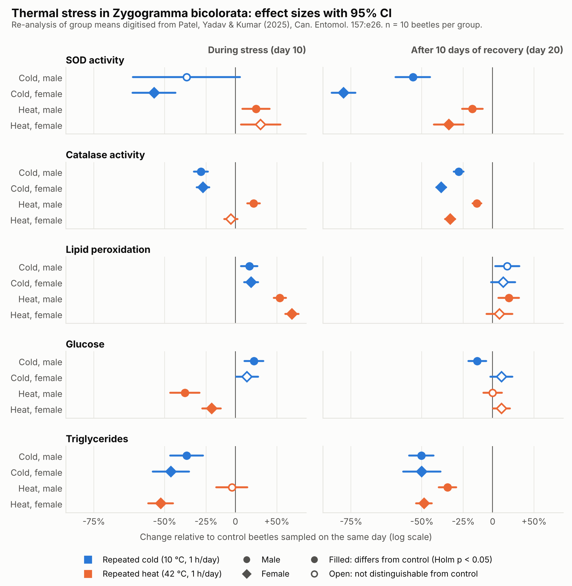
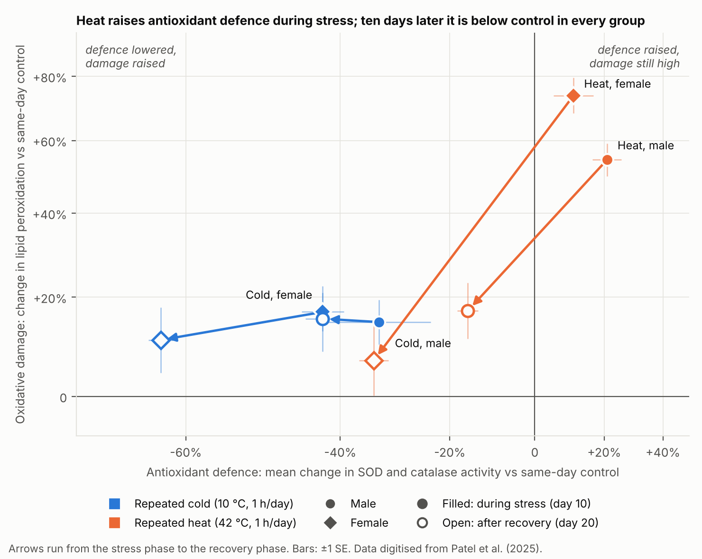
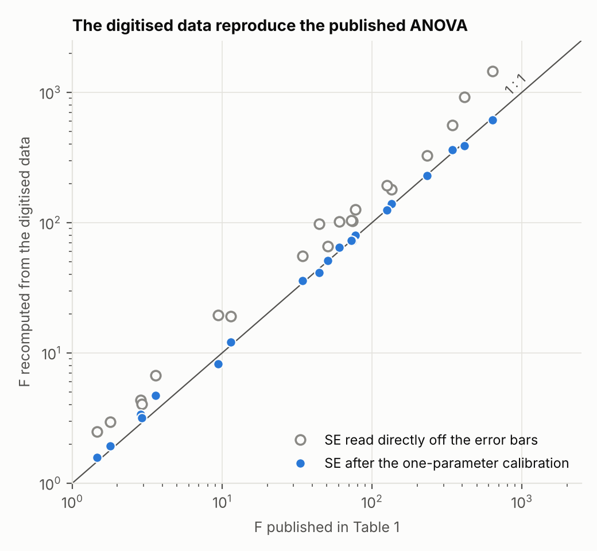

# Thermal stress in the Parthenium beetle: a re-analysis of published data

A reproducible re-analysis, in Python, of the antioxidant and energy-reserve data in

> Patel, A.K., Yadav, P. & Kumar, B. (2025). Physiological responses of Parthenium beetles,
> *Zygogramma bicolorata* Pallister (Coleoptera: Chrysomelidae), to fluctuating temperature
> stress. *The Canadian Entomologist* 157: e26. https://doi.org/10.4039/tce.2025.10012

**Whose data this is.** The experiments, the measurements and the original analysis are those of
the authors above. I am not an author of that paper. This repository starts from its published
figures and tables and asks what more can be learned from them.

I worked with this dataset for my M.Sc. dissertation at Banaras Hindu University (2026) and took part in the laboratory work in Prof. Bhupendra Kumar’s group. This repository is an independent re-analysis that goes beyond what I did in the dissertation.

## The experiment, in three lines
Adult beetles were exposed for 1 hour a day, for 10 days, to heat (42 °C) or cold (10 °C), or
kept at 27 °C throughout (control). All beetles then spent 10 more days at 27 °C. SOD, catalase,
lipid peroxidation (TBARS), glucose and triglycerides were measured in 10 males and 10 females
per group after the stress phase (day 10) and after the recovery phase (day 20).

## What this re-analysis adds

**1. A data table.** The paper shows group means only as bar charts. `data/digitised_means.csv`
holds all 60 means with standard errors, measured from the figures by script. The table
reproduces the paper's own statistics: recomputed F-ratios are 0.93 to 1.18 times the 15
published main-effect values, and exactly one set of whole-number mortality percentages
compatible with the digitised bars gives the published chi-square of 53.88.

**2. Effect sizes against the right baseline.** Unstressed control beetles changed a lot between
the two sampling days: SOD activity rose by 56 % in males and 109 % in females, catalase by 45 %
and 60 %, triglycerides by 69 % and 16 %. So each stressed group is compared here with the
control sampled on the same day, as a percentage change with a 95 % interval.



**3. What that shows.**
- *During stress*, repeated heat raised lipid peroxidation by 54 % (males) and 74 % (females).
  SOD rose by 22 % in males and 28 % in females (the female interval is wide, +6 to +56).
  Catalase rose only in males (+19 %); in females it did not change (-4 %, interval -10 to +2),
  and females showed the larger rise in lipid peroxidation.
- Repeated cold lowered catalase by 27 to 29 % and SOD by 55 % in females (the male estimate,
  -38 %, is imprecise), with a smaller rise in lipid peroxidation (+15 to +17 %).
- *Ten days after the last exposure*, SOD (-18 to -77 %), catalase (-14 to -40 %) and
  triglycerides (-36 to -50 %) were below the same-day control in all four stressed groups.
  Lipid peroxidation was only 7 to 17 % above control, and distinguishable from control in one
  group of four after correcting for multiple comparisons.
- Read against same-day controls, the lasting mark of repeated thermal stress in these data is
  lower antioxidant activity and depleted lipid reserves, not continuing oxidative damage.
- Catalase in cold-exposed males went from 86 to 125 U/mg between day 10 and day 20, but
  controls rose in parallel: the deficit relative to control was -29 % on day 10 and -28 % on
  day 20. The rise over time is shared with unstressed beetles.



**4. Mortality on counts.** Heat-exposed beetles died at 3.2 times (males) and 4.0 times
(females) the control rate; cold-exposed beetles at 1.8 and 2.0 times. Pooled over regimes, the
odds of death were 1.40 times higher in males than in females (95 % CI 1.17 to 1.68). The
published chi-square (53.88) corresponds to a test on the six percentages; on the numbers of
beetles the statistic is about 160. The conclusion does not change.

All numbers above are in [`results/summary.md`](results/summary.md), which the pipeline writes.

## How the standard errors were recovered
The error bars in the figures are 1 to 6 pixels long, too short to read reliably. The published
F-ratios give a way round: F = MS_effect / MS_error, and MS_effect depends only on the means, so
each published F implies the pooled within-group variance. Comparing that with the whisker
readings showed the readings were short by a constant 0.83 px. After adding it, the recomputed
ANOVA matches Table 1, including the five interaction terms that were not used in the fit.
Details in [`docs/METHODS.md`](docs/METHODS.md).



## Run it
```bash
pip install -r requirements.txt
python run_all.py        # steps 2-6, writes results/
pytest                   # 12 tests
```
Step 1 (digitising) needs the three figure images from the paper in `figures_src/`; they are not
redistributed here. The script header explains how to extract them from the PDF. Without them
the pipeline uses the digitised table already in `data/`.

## Layout
```
data/        digitised means, mortality, the published ANOVA table, provenance notes
scripts/     01 digitise  02 calibrate + ANOVA  03 effect sizes  04 mortality  05 figures  06 cross-species
zbico/       statistics from summary data (lnRR, Hedges' g, factorial ANOVA, chi-square, Mantel-Haenszel)
tests/       checks against scipy, statsmodels and the published statistics
results/     tables, figures, summary.md
docs/        METHODS.md, EXTENSION_cross_species.md, LEARNING_LOG.md
```

## Limitations
- Works from 60 group means, not the 600 individual measurements.
- Standard errors rest on the calibration described above.
- The day-10 to day-20 change in controls may reflect age, assay run, or both; the data cannot
  separate them.
- One species, one population, one laboratory. Whether the pattern is general is the subject of
  the planned extension in [`docs/EXTENSION_cross_species.md`](docs/EXTENSION_cross_species.md).


## How this was built
The code was written with the help of an AI assistant (Claude). I chose the questions,
checked every result against the published paper, and wrote the interpretation.
I can explain and modify every step; my notes are in `docs/LEARNING_LOG.md`.

## Licence
Code: MIT. Data: measurements reported by Patel, Yadav & Kumar (2025); cite the paper.

## Author
Abhishek Kumar Mandal, M.Sc. Zoology, Banaras Hindu University
abhishekdhn2002@gmail.com · [LinkedIn](https://www.linkedin.com/in/abhishek-kumar-mandal-6750a0315)
